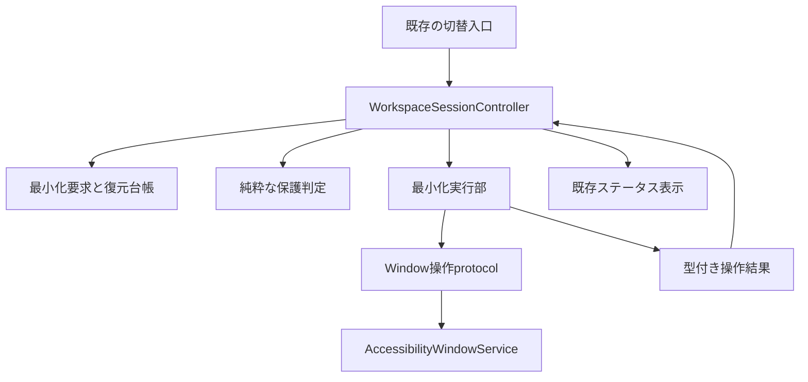
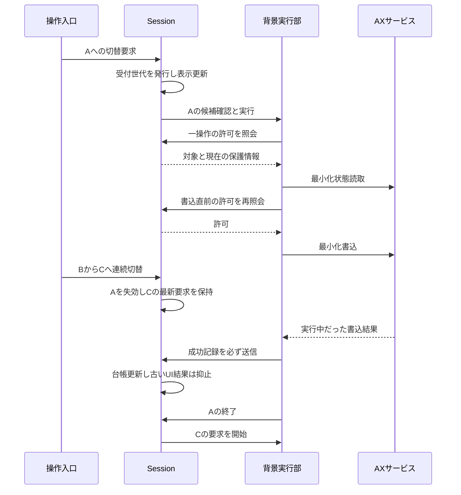
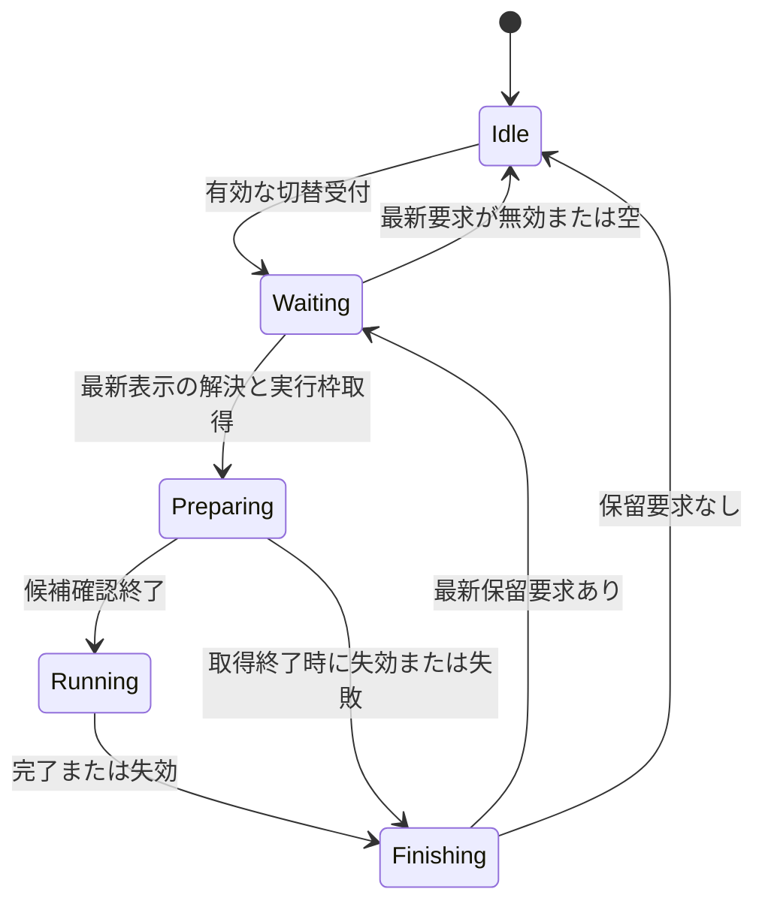

# 技術設計：Board切替時の最小化改善

## Overview

通常版WindowBoardの切替後に未登録ウィンドウが残る問題に対し、候補確認、最新要求への切替、登録保護、復元記録を一つの処理契約として整える。要件33基準を対象とし、利用者は主画面・Status Item・Quick Launcherの既存入口を使い続ける。

採用構成は既存Sessionの拡張と、純粋な判定・背景実行の抽出を組み合わせるハイブリッド方式である。状態・要求・復元台帳はSessionだけが所有する。新しい実行部は実行中のローカル処理だけを持ち、AX境界を迂回しない。本書の型・ファイルは設計契約であり、現時点の実装済みAPIではない。

### Goals

- 登録窓のキャッシュ解決成功と未登録候補の確認を切り離し、表示後に必要な候補を補完する。
- 連続切替・手動最小化との重複でも最新要求を失わず、操作が落ち着いた時点で最新の対象へ整える。
- 実行済み操作の記録と画面への結果適用を分け、部分失敗と古い結果の双方で復元可能性を保つ。

### Non-Goals

Tree版や試作の機能追加、平坦グループ、保存形式変更、配置保存の意味変更、Follow/前面化の全面改修、常時ウィンドウ監視を行わない。Terminal保護・空の構成・自動最小化の既定値を変更しない。明示復元と切替の新しい優先順位は導入しない。

## Boundary Commitments

### This Spec Owns

- 切替時自動最小化の要求受付から候補確認、操作、部分失敗、完了まで。手動最小化の準備・操作・完了も同じ有効性確認と実行枠へ接続する。
- 最小化対象と登録保護の純粋な判定、AX取得の診断結果、最小化/復元の操作結果契約。
- Session内の最小化要求状態とインメモリ復元台帳。明示復元については台帳の差分更新・読取不明時の保持に限って変更する。
- 既存ステータス表示で未完了と完了を区別すること、Debug診断による対象除外・失敗・中断の分類。

### Out of Boundary

- Board読込みのキュー、保存・合成構造、復旧先の照合・再オープン方式は既存責務に残す。
- 配置の適用、Follow、前面化を最小化専用の実行部へ移さない。既存の前面化コールバックの呼出時点も維持する。
- 明示復元を自動処理より優先/劣後させる新しいスケジューラは作らない。既存の操作可否を維持し、重なった場合の台帳消失だけを防ぐ。
- OSが公開しないウィンドウ、他Space移動、フルスクリーン制御、同期AX呼出の強制取消を保証しない。

### Allowed Dependencies

- 依存方向は `Models → AXサービスと実行部 → Session → 画面と操作入口`。右側は左側を利用でき、左側はSession/Store/Viewを参照しない。
- Sessionは既存Store、構成Resolver、windowServiceFactoryを使う。実行部は注入されたWindow操作サービスと型付きコールバックのみを使う。
- AppKit/ApplicationServicesの直接AX呼出はAccessibilityWindowService内に限定。実行部はprotocol越しに呼ぶ。
- Sessionの変更はSession/Workspace担当一人が所有し、AX担当とRegression担当は契約・テストを別ファイルで扱う。

### Revalidation Triggers

- AX結果型・既存protocolの互換既定実装の変更は、Snapshot/Recovery/Launcher/Treeとfakeのコンパイル・契約を再確認する。
- 登録集合・実ウィンドウidentity・同一アプリ保護の変更は、合成構成、Terminal、VS Code、再接続を再検証する。
- 要求受付・busy・完了通知の変更は、主画面/Status Item/LauncherとSnapshotの停止・再開を再検証する。
- 保存値や設定の意味を変える場合は本仕様の境界を再審査する。新しいOS要件や外部依存を追加する場合も同様とする。

## Architecture

### Existing Architecture Analysis

現在の切替はSessionがplaceholderを先行表示し、背景で解決・配置・復旧・最小化を行う。登録のキャッシュ解決に成功すると全列挙を省略する。最小化は固定した登録情報を150ms後に使い、実行中なら新要求を捨てる。旧自動結果は履歴追加前に破棄され、手動の古い準備/完了には世代検査がない。

既存のworkspaceSwitchRevisionは読込み実行開始で増え、読込み中の新要求受付時には増えない。従って最小化用の受付世代を別に設け、既存pendingWorkspaceSwitchは読込み専用のまま保つ。

### Architecture Pattern & Boundary Map



新しい常駐Coordinatorや汎用ジョブキューは導入しない。実行部は一つの要求について候補と操作を処理し、要求の有効性はSessionへ問い合わせる。自動/手動最小化の同時実行枠はSessionに一つだけ存在する。

### Technology Stack

| 層 | 技術・設定 | 本機能での用途 | 変更 |
| --- | --- | --- | --- |
| 状態/表示 | Swift言語モード5.0、Combine、SwiftUI | 要求状態と既存メニュー表示 | 新ライブラリなし |
| 非同期実行 | Swift Concurrency、既存の背景Task方式 | 取得/読取/書込と短いMainActorチェックポイント | Swift 6全体移行は対象外 |
| macOS操作 | AppKit、ApplicationServices、macOS 14.0以上 | 公開AXの列挙・最小化・復元 | Scene/ウィンドウ復元API変更なし |
| 診断/検証 | OSLog、XCTest | 分類ログと制御可能なfake | 保存/配信基盤変更なし |

Swiftの取消は協調的であり、取消要求だけで任意の同期関数が止まるとは扱わない。[Apple Task.cancel](https://developer.apple.com/documentation/swift/task/cancel%28%29)を根拠に、操作境界での確認と実行済み結果の回収を契約にする。

## File Structure Plan

### Directory Structure

| 区分 | ファイル | 一つの責務・ターゲット |
| --- | --- | --- |
| 新規 | `WindowBoard/Models/WindowOperationInspection.swift` | 列挙・状態読取・エラーの共通結果型。WindowBoardとAXサービスを共有するWindowBoardTreeへ登録 |
| 新規 | `WindowBoard/Models/WindowMinimizationModels.swift` | 要求、進捗、候補、操作結果、台帳entryの値型。WindowBoardのみ |
| 新規 | `WindowBoard/Models/UnattachedWindowMinimizationPolicy.swift` | 保護/対象の理由付き純粋判定と候補統合。WindowBoardのみ |
| 新規 | `WindowBoard/Services/UnattachedWindowMinimizationExecutor.swift` | 一要求の背景取得・操作・結果送信。WindowBoardのみ |
| 変更 | `WindowBoard/App/WorkspaceSessionController.swift` | 要求状態、実行枠、台帳、既存入口/復旧への接続。private状態を別拡張へ無理に公開しない |
| 変更 | `WindowBoard/Services/AccessibilityWindowService.swift` | 診断付き取得を追加し既存戻り値の互換を維持 |
| 変更 | `WindowBoard/App/WindowBoardStatusItemController.swift` | MainActor隔離、表示用状態と進捗の購読。メニュー操作経路は維持 |
| 新規 | `WindowBoardTests/WindowMinimizationPolicyTests.swift` | 対象/保護・候補統合の純粋テスト |
| 新規 | `WindowBoardTests/WindowMinimizationExecutorTests.swift` | 読取/操作/失効/結果分類のテスト |
| 新規 | `WindowBoardTests/WorkspaceMinimizationTests.swift` | Sessionの連続切替・手動重複・台帳・進捗の統合テスト |
| 新規 | `WindowBoardTests/WindowOperationInspectionTests.swift` | 互換既定実装と診断付き取得結果の変換テスト |
| 新規 | `WindowBoardTests/Support/ControlledMinimizationWindowService.swift` | 同期化したfake・列挙/操作gate・イベント記録 |
| 変更 | `WindowBoardTests/WindowMatchingTests.swift` | 既存の高速切替・復元・保護テストの互換確認と該当テストのMainActor指定。private fakeは移動しない |
| 変更 | `WindowBoard.xcodeproj/project.pbxproj` | 明示的な参照とSourcesへの新規ファイル登録 |

### Modified Files

上表以外の本番ファイルは変更しない。ContentView、Launcher、AppState、BoardCompositionStoreは既存入口と表示/座標/保存契約を保つ参照先であり、実装者が必要性なく変更対象へ広げない。共通AX結果型だけはTreeのコンパイルにも必要となるが、Treeの機能は変更しない。

APP_REQUIREMENTS.mdは既存動作を回復する修正として原則維持する。ユーザー向け意味を変える必要が生じた場合は、本設計の再審査後に更新対象とする。

## System Flows

### 最新要求への引継ぎ



### Session所有の状態遷移



Waitingは最新要求の待機を示し、旧operationがまだAXから戻っていない場合もある。図の表示状態と実行枠の所有を混同しない。Finishは成功・失敗・取消・空対象のすべてから到達する共通経路である。

## Requirements Traceability

| Requirement | Summary | Components | Interfaces | Flows |
| --- | --- | --- | --- | --- |
| 1.1, 1.2 | 未登録候補補完 | Session、Executor、Policy | CandidateSnapshot、listWindowsReport | 候補確認 |
| 1.3, 1.4 | OFF/空構成 | Session | acceptSwitchIntent | 受付/失効 |
| 2.1, 2.2 | 表示先行と受付継続 | Session | materializeAutomaticRequest | 最新要求への引継ぎ |
| 2.3 | 未完了表示 | Session、Status Item | minimizationProgress、displayStatusMessage | 状態投影 |
| 3.1, 3.2, 3.3 | 最新要求を保持 | Session | finishOperation、drainLatest | 最新要求への引継ぎ |
| 3.4, 3.5 | 古い操作/結果抑止 | Session、Executor | authorizeStep、commitReceipt | 操作チェックポイント |
| 3.6 | 実行中最小化の補償 | Session、Executor | restorePlan | 最新登録復元 |
| 4.1, 4.2 | 登録保護と復元 | Policy、Session、Executor | ProtectionSnapshot、authorizeStep | 最新登録復元 |
| 4.3, 4.4 | 登録維持/既存保護 | Policy、Session | classification | 対象判定 |
| 4.5 | 同一構成の選択 | Session | requestMemberSelection維持 | 起動対象外 |
| 5.1, 5.2 | 部分失敗後の続行と表示 | Executor、Session | StepReceipt、OperationSummary | 部分失敗/完了 |
| 5.3 | 取得失敗と正常ゼロ件 | AXサービス、Executor | WindowEnumerationReport | 候補確認/診断 |
| 5.4 | 古い成功も記帳 | Session | commitReceipt | 台帳差分 |
| 5.5, 5.7 | 明示復元と失敗保持 | Session、AXサービス | LedgerRestoreTarget、minimizedObservation | 台帳差分 |
| 5.6, 5.8 | 既最小化のno-op | Executor、Session | StepOutcome | 操作/台帳差分 |
| 6.1 | 入口の一貫性 | Session、Policy | 共通の自動要求 | 候補確認 |
| 6.2, 6.3 | 保存/復旧意味維持 | Session | 既存切替/復旧契約維持 | 対象外処理の維持 |
| 7.1, 7.2 | 判定/操作分類 | Policy、Executor、AXサービス | OperationSummary、WindowInspectionIssue | 診断 |
| 7.3, 7.4 | 引継ぎ診断と通常操作 | Session、Executor | operationIDとintentID | 状態投影/診断 |

## Components and Interfaces

| Component | Domain | Intent | Requirements | Key Dependencies | Contracts |
| --- | --- | --- | --- | --- | --- |
| WorkspaceSessionController | App | 要求・実行枠・台帳と結果公開 | 1.1, 2.3, 3.1, 5.4, 6.1 | Policy P0、Executor P0、既存Store P0 | Service、State |
| UnattachedWindowMinimizationPolicy | Models | 理由付き登録保護と候補統合 | 1.2, 4.1, 4.4, 7.1 | WindowInfoと値型 P0 | Service |
| UnattachedWindowMinimizationExecutor | Services | 一要求の背景処理 | 2.1, 3.5, 5.1, 7.2 | Window操作protocol P0、Sessionコールバック P0 | Service |
| AccessibilityWindowService | Services | 診断を失わないAX境界 | 5.3, 5.7, 7.2 | 公開AX API P0 | Service |
| WindowBoardStatusItemController | UI | 最新処理の表示状態を購読 | 2.3, 7.4 | Session P1 | 既存表示契約 |

### App：WorkspaceSessionController

**責務と依存**：Inboundは既存入口（P0）、OutboundはPolicy/Executor（P0）と既存Store（P0）。Sessionが要求・台帳を所有し、Storeへ最小化結果を書き込まない。Contracts: Service [x] / State [x]。

```swift
@MainActor
func acceptSwitchIntent(target: SavedWorkspace.ID,
                        automaticEnabled: Bool) -> MinimizationIntentID
@MainActor
func materializeAutomaticRequest(intent: MinimizationIntentID,
                                 resolution: MinimizationResolution)
@MainActor
func authorizeStep(_ proposal: StepProposal) -> StepAuthorization
@MainActor
func commitReceipt(_ receipt: StepReceipt)
@MainActor
func finishOperation(_ result: MinimizationOperationResult)
```

これらはinternal/private契約であり、既存のpublicなswitchWorkspace等の引数を変更する必要はない。既存pending switchの内部データにはintentIDと受付時設定を追加し、再投入は同じIDを継承する。クラス全体のMainActor化は行わず、新しい状態を読む/書く入口をMainActorへ限定する。具体的にはswitchWorkspace、switchWorkspaceFromLauncher、restoreLayoutFromLauncher、requestMemberSelection、minimizeUnattachedWindows、restoreMinimizedWindowsと新規状態更新メソッド、applyDeferredRecoveryをメソッド単位でMainActorにする。Status ItemはUIライフサイクルとselectorを含むクラスをMainActorに明示隔離し、既存UI/LauncherのMainActor経路から呼ぶ。該当既存テストはメソッド単位でMainActor化する。非隔離の同期メソッドから隔離メソッドを直接呼ぶ隠れた前提を残さない。executorからSessionを直接参照しない。

**状態契約**：

- intentIDは単調増加UInt64、operationIDはUUID。workspaceSwitchRevisionは従来用途を維持し、二つを相互代用しない。
- 登録先検証後、実際の切替要求受付でintentを更新する。読込み中にキューへ入る場合も更新する。純粋なメンバー選択経路は更新しない。
- Sessionは最新intent、最新自動要求最大1件、実行中の手動/自動operation最大1件、task handle、進捗、台帳を保持する。新しい切替で古い保留要求を置換する。
- 読込み結果のmaterializeは最新intentとターゲットの両方が一致するときだけ行う。設定ONかつ合成参照非空なら要求を保留する。OFF/空は古い操作を失効させ、新たな最小化/補償復元を作らない。
- 同一ターゲットに対する読込み中の最新受付も、最後のintentと受付時automaticEnabled、source、notBefore、表示コールバックへ解決結果を結び直す。既存のselectedBoardIDだけの継承で済ませない。古いIDの完了が自動要求を復活させない。
- 同intentの保留要求はfullとreconcileを合流し、fullを優先する。reconcileで未処理のfullを置換しない。既存自動復旧の完了だけが、最新かつ自動最小化ON・非空としてmaterialize済みのintentへreconcileを要求できる。同intentでのsummaryは実操作receiptを重複排除して累積し、追加確認の成功0件で以前の失敗数を消さない。
- 手動最小化は従来のbusy時受付抑止を維持するが、開始した手動要求の準備からfinishまで同じoperationIDを使う。その間の新切替は受付・保持する。手動開始は現在のintentへ結び付け、新しい切替intentを発行せず、完了済み自動fullも再投入しない。有効な自動pendingがあればbusyとして手動の新規実行を抑止する。
- finishは台帳結果を適用し、自分のoperationIDが枠所有者の場合だけ枠を解放し、成功/失敗/空対象/失効のすべてで最新保留要求をdrainする。古い完了は新operationを解除しない。
- 書込成功receiptはintent失効後も冪等に記帳する。UI、接続更新、候補更新コールバックはintent・operation・元の実窓identityが現行と一致する場合だけ適用する。

**進捗とSnapshot**：`MinimizationProgress` は `.notRequested / .waiting / .preparing / .running / .completed(summary)`。`isMinimizingUnattached` は実行枠と保留中の有効要求からSessionが更新し、旧workerから直接falseにしない。表示済み要求の待機・準備もbusyに含め、Snapshotの既存Activityによる停止を継続する。最新要求が終わり枠が空になれば停止を解除する。

`displayStatusMessage` は待機/準備/実行中だけ「Board表示済み、ウィンドウ処理中」に相当する表示を優先し、それ以外は既存statusMessageを返す。finishは最新要求に限って最小化/復元成功数、失敗件数、一覧確認の不完全性をstatusMessageへ公開する。全背景復旧やFollowの総合進捗にはしない。Status Itemは進捗とstatusMessageを購読し、この表示を使う。

### Models：UnattachedWindowMinimizationPolicy

**責務と依存**：InboundはSession/Executor（P0）、Outboundは既存WindowInfoとモデル型（P0）。副作用・永続化・Taskを持たない。Contracts: Service [x]。

```swift
static func classify(_ candidate: WindowInfo,
                     protection: ProtectionSnapshot) -> CandidateClassification
static func mergeCandidates(report: WindowEnumerationReport,
                            fallback: [WindowInfo]) -> [MinimizationCandidate]
```

classificationは `.target / .registered / .sameApplicationProtected`。登録一致のID、PIDとwindowNumber、従来のタイトル/位置照合、Terminal包括保護、VS Code例外の順序と意味は既存から移す。位置等が変わる場合は最新の値をsnapshotへ含める。

候補統合は新しいreportの同一IDの値を優先する。completeなら通常キャッシュの古い候補を追加しない。partial/failed/unverifiedLegacyでは正常に得た候補を優先し、取得失敗したアプリまたは未確認範囲の既知候補だけをfallbackとして明示する。fallbackも操作前に生存/状態を読み、既知キャッシュを「完全な一覧」と扱わない。既存の汎用mergeWindowsの意味は変更しない。

### Services：UnattachedWindowMinimizationExecutor

**責務と依存**：InboundはSession（P0）、Outboundは注入Windowサービス（P0）と型付きコールバック（P0）。Session/Store/Viewを保持しない。Contracts: Service [x]。

```swift
func run(request: MinimizationExecutionRequest,
         service: any WorkspaceWindowOperating,
         authorize: @escaping @MainActor (StepProposal) -> StepAuthorization,
         restorePlan: @escaping @MainActor () -> ProtectionSnapshot,
         record: @escaping @MainActor (StepReceipt) -> Void)
    async -> MinimizationOperationResult
```

Sessionが既存方式の背景Task内でserviceを生成してrunを呼ぶ。serviceをMainActor上で使わず、列挙・状態読取・書込は背景実行する。authorize/restorePlan/recordの呼出だけをawaitしてMainActorで行う。既存型を無理に全体Sendableへ変更せず、可変Sessionを背景に共有しない。Swift言語モード5.0下でのコンパイル警告と引渡しの監査を検証項目にする。

**候補契約**：自動要求は同じintentの解決段階で得た診断付きreportを再利用する。cache-onlyや別intentのreportしかなければ表示後に診断付き列挙を追加1回行う。失敗/部分失敗を含め、同一要求内で全列挙を自動再試行しない。自動OFF/空なら本機能用の列挙を行わない。手動は既存のrefreshWindowList指定を保つが、診断付き取得を行う場合は同じreport契約を使う。

**操作チェックポイント**：各候補の読取前にauthorizeし、状態読取後、書込直前に再びauthorizeする。後者で実窓identityまたは対象判定が変われば書き込まず再評価する。現在登録であればskipする。失効なら打ち切る。確認と同期AX開始の間の切替はinflight一操作として扱い、戻ったreceiptを必ずrecordした後、次の操作へ進む前に再確認する。

recordは成功時にawaitしてから次へ進む。Task取消や失効を理由にreceiptを捨てない。CancellationErrorも操作結果を回収してfinishへ到達する経路へ変換する。各stepのstepIDはoperation内の単調連番とし、重複receiptを二重集計しない。

**登録復元**：候補の最小化後はrestorePlanから最新の登録集合とfingerprintを取得し、availableな最小化済み登録を復元する。各書込直前にも同一登録の現在の実窓identityを確認し、WindowOperationPermitへ現在の台帳entryVersionを取り込む。fingerprintが変わった場合、全列挙せず固定候補の全体を再分類する。以前registeredとしてskipした候補も含め、現在は対象となった候補へ操作し、現在の登録を保護・復元する。候補分類の集計は最新fingerprintの結果で置換し、実操作はstepID単位で数えて再評価だけでは二重計上しない。操作が落ち着けば有限に終わる。

同じintentに属する既存の背景復旧が後から完了した場合、SessionのapplyDeferredRecoveryから固定候補の再分類と登録復元のreconcile要求を合流させる。Sessionは最新の適格な自動intentの候補snapshotを次の切替まで保持し、その既存候補だけを再評価する。新しい窓を列挙して対象集合へ追加せず、同切替の復旧で旧登録窓が未登録となった場合も扱う。別intentへ進んでいれば破棄する。明示復旧や後日の新規窓作成を常時監視する機能にはしない。

### Services：AccessibilityWindowServiceと診断付き取得

**責務と依存**：InboundはWindow操作protocol利用者（P0）、Externalは公開AX API（P0）。Contracts: Service [x]。

```swift
// WorkspaceWindowOperatingへの追加要件。既存メソッドは維持する。
func listWindowsReport() -> WindowEnumerationReport
func minimizedObservation(of window: WindowInfo) -> MinimizedObservation
```

protocol extensionは旧サービス/fake互換の既定実装を持つ。一覧は既存listWindowsを包みcoverageをunverifiedLegacyにする。状態は既存isMinimizedのBoolをsuccessとして包むがqualityをlegacyとし、失敗診断能力があるとは扱わない。本番AccessibilityWindowServiceは必ず診断付きの実装を提供し、新テストfakeも明示実装する。既定実装は移行互換であり本番診断要件の証明には使わない。

本番の旧listWindowsと新reportは共通の内部取得処理へ委譲し、互いを再帰的に呼ばない。旧isMinimizedは従来のBoolフォールバックを維持し、新観測はエラーを保持する。Snapshot/Recovery/Launcher/Treeの既存呼出意味を変えない。

| 結果 | 意味と契約 |
| --- | --- |
| complete | 現行対象アプリと通常窓フィルタの範囲内で取得成功。正常ゼロ件も含む。全Space等の存在保証ではない |
| partial | 一部アプリ/要素取得に失敗。正常取得候補、失敗PIDとissueを保持 |
| failed | 権限不足等で取得不能、または取得対象すべてが失敗。正常ゼロ件と区別 |
| unverifiedLegacy | 旧配列しか得られず成功範囲が不明。完全性を主張しない |

roleによる正当な除外と、role/位置/サイズの読取不能による脱落はissueで区別する。CF値の型検査を行い、診断のために強制castを追加しない。最小化状態は正常Boolと失敗Resultを区別する。

本番report構築はAccessibilityWindowService内のinternalな純粋集約関数へ分け、PIDごとの取得結果・正常候補・issueからcoverageを決める。Bool属性のCF型検査もraw値とAXErrorを入力するinternal変換関数にし、本番取得とテストで同じ変換を使う。外部APIや汎用AXラッパーは新設しない。完成済みreportを返すfakeのテストとは別に、この本番変換をWindowOperationInspectionTestsで検証する。

### UI：WindowBoardStatusItemController

クラスのMainActor隔離を明示し、進捗購読を既存のCombine購読へ追加し、表示文言の供給元をdisplayStatusMessageへ変更する。選択Board・アイコン・最小化/復元ボタンの既存意味は維持する。ContentView側はSessionのbusy投影を通じて既存ToolbarとSnapshotへ反映され、新しいパネルは作らない。

## Data Models

### Domain Model

全モデルはアプリ実行中の値であり、Codable保存項目を追加しない。

| 型 | フィールド/variant | 不変条件 |
| --- | --- | --- |
| WindowInspectionIssue | stage enum、pid: pid_t?、windowID: String?、failure: ax(AXError)またはinvalidValue。Error準拠 | タイトル・文書URLを診断へ含めない |
| WindowEnumerationReport | windows: [WindowInfo]、coverage enum、issues、failedPIDs: Set<pid_t> | partialでも正常候補を保持 |
| MinimizedObservation | state: Result<Bool, WindowInspectionIssue>、quality: diagnosticまたはlegacy | unknownをfalseへ置換しない |
| MinimizationIntentID | value: UInt64 | 受付世代。永続化しない |
| MinimizationResolution | targetBoardID、composedReferenceIDs、解決済みreport?、switchRevision、notBefore: ContinuousClock.Instant | 受付intentに関連付け、時刻だけで有効性を判断しない |
| MinimizationExecutionRequest | intentID、operationID、kind: automatic/manual/reconcile、candidateSource: CandidateSource | operationは同時に最大1件 |
| CandidateSnapshot | report、origin: switchResolution/minimization/legacyCache、intentID、capturedAt: ContinuousClock.Instant | reportの再利用は同intentだけ |
| CandidateSource | reuse(CandidateSnapshot)、refresh(fallback: [WindowInfo])、known([WindowInfo]) | 自動fullはreuse/refresh、手動は既存指定に沿うknown/refresh、reconcileは保持済みsnapshotのreuse |
| MinimizationCandidate | window: WindowInfo、provenance: freshまたはfallback | freshの同一IDを優先 |
| ProtectionSnapshot | attached records、fingerprint | attachmentID、実窓identity、available/reconnecting、照合に使う位置/タイトルを含む |
| LiveWindowIdentity | pid、windowID、windowNumber? | 別プロセスや別の実窓を同じ台帳entryにしない |
| StepProposal | operationID、intentID、stepID、kind: minimizeCandidate/restoreAttachment、candidateIdentity、candidateWindow: WindowInfo、attachmentID?、expectedLedgerVersion? | 許可は一つの操作に限定。candidateWindowのidentity一致を確認 |
| StepAuthorization | perform(WindowOperationPermit)、skip(reason)、stop(reason) | perform後も実窓の再照合を省略しない |
| StepReceipt | operationID、intentID、stepID、identity、window、desiredMinimized、outcome、expectedLedgerVersion? | 操作結果と画面適用可否は別 |
| StepOutcome | changed、alreadyDesired、readFailed(issue)、writeFailed(issue, observedAfter?)、skipped(reason)、superseded | changedは書込成功を意味し物理アニメーション完了保証ではない |
| OperationSummary | 候補/保護/no-op/成功/失敗数、取得issues、中断理由、coverage | 不明を成功/no-opへ数えない |
| MinimizationOperationResult | operationID、intentID、summary、終了理由 | 成功・空・失敗・失効の全終了を表す |
| MinimizedLedgerEntry | identity、window、entryVersion: UInt64、insertionOrder: UInt64 | 最小化成功ごとにversionを更新 |
| LedgerRestoreTarget | identity、window、expectedEntryVersion | 復元結果で新しい記録を消さない |

### Logical Data Model：台帳と一貫性

既存 `minimizedWindows` は外部から読取可能なPublishedのprivate(set)投影として維持する。既存rememberMinimizedWindowをMainActor上の台帳追加へ接続し、直接配列を代入している既存テストはこの入口で準備する。投影は初回追加順を保ち、辞書順に依存しない。台帳のkeyはLiveWindowIdentityであり、entryVersionはSessionが単調増加で発行する。明示復元も一窓の観測/書込直後に結果をMainActorへ送り、適用のawait完了後に次の窓へ進む。バッチ終了時だけの成功反映はしない。開始前から最小化済みの窓を新規追加せず、normal観測後の最小化書込成功だけを追加する。

明示復元の開始時にidentityとentryVersionを取り込む。成功またはnormal確認はそのversionに一致するentryだけを削除する。復元書込失敗後にまだminimized、または読取不能なら保持する。途中で同じ窓が再最小化されversionが進んだ場合、古い復元結果では削除しない。失敗配列への全置換は廃止する。

自動処理の登録復元も同じversion条件で台帳を差分更新する。windowIDの再接続が起きても保存済みreferenceの所有やIDを変更せず、旧実窓の台帳は別の記録として扱う。receiptはoperationIDとstepIDで重複排除し、operation終了後に重複追跡を解放する。

## Error Handling

### Error Strategy

| 状況 | 応答と結果記録 |
| --- | --- |
| 一覧取得がpartial/failed | 成功候補・限定fallbackを処理し、確認不完全を記録。無限再列挙しない |
| 状態読取unknown | その操作を失敗として一度集計し書込を省略。他窓へ続行。台帳を削除しない |
| 最小化前からtrue | alreadyDesired。失敗でも新規成功でもなく、新規台帳追加なし |
| normalから最小化書込成功 | changedとして即時receiptを送り、失効後も記帳する |
| 復元前からfalse | alreadyDesired。version一致時だけ既存台帳から削除 |
| AX書込失敗 | 一操作の失敗を一度集計。最小化成功は推測しない。復元失敗時は必要な状態読取でnormal確認できた場合だけ同versionを削除 |
| 要求失効 | 書込前なら停止。書込中なら結果回収後停止。台帳記録と中断診断は残しUIの古い完了は抑止 |

成功は事前状態の正常観測とAX書込のsuccessによる操作成功と定義する。必須の事後読取は追加せず、表示アニメーションの完了は実機確認と分ける。事後読取失敗によって、書込成功した記録を捨てない。AXエラーの区別は[Apple AXError](https://developer.apple.com/documentation/applicationservices/axerror)とSDKのAXUIElement.hを参照した。

### Monitoring

Debugで一要求あたりの集計を基本に、intentID、operationID、Board ID、候補取得回数、coverage、保護理由別数、no-op、成功、失敗、中断、引継ぎを記録する。必要な個別失敗にはPID、操作種別、AXErrorだけを残し、タイトル/URL/文書内容をログへ追加しない。一般操作でログ閲覧や新しい権限確認を必須にしない。

## Testing Strategy

### Unit Tests

| 対象 | 具体的な検証 | 基準 |
| --- | --- | --- |
| Policy | ID/番号/従来の曖昧一致、Terminal保護、VS Code例外、全同時表示Boardの保護 | 4.1, 4.4 |
| Policy | 同IDで新しいreport優先、completeで古い候補を落とす、partialの失敗PID fallback | 1.1, 1.2, 5.3 |
| Inspection | 正常0件/部分成功/全失敗/legacy、型不一致/読取不明の分類 | 5.3, 7.2 |
| Executor | normal書込成功、既true no-op、unknown、個別失敗後の続行、receipt冪等性 | 5.1, 5.6, 5.8, 7.1, 7.2 |
| Executor | read前/write前の許可、許可後inflight成功回収、失効後の次操作なし | 3.5, 5.4, 7.3 |

### Integration Tests

| シナリオ | 観測する結果 | 基準 |
| --- | --- | --- |
| cache登録解決済み＋未登録窓追加 | 表示は補完gate解放前。追加窓へ最小化を試行 | 1.1, 1.2, 2.1 |
| OFF/空構成/同一構成選択 | 本機能用の追加列挙・最小化0回。追加Boardだけ非空は対象 | 1.3, 1.4, 4.5 |
| A write中にB→Cを受付 | C保持、旧追加write停止、C登録の復元、最終対象へ試行 | 2.2, 3.1, 3.3, 3.6, 4.2 |
| 読込みpending中に次の受付 | intentを受付時に失効、旧load完了から自動要求が復活しない | 3.1, 3.4, 3.5 |
| manual準備中/実行中/失敗時に切替 | stale接続更新なし、全終了経路から最新要求をdrain | 3.2, 3.4 |
| stale成功と台帳 | 旧成功も残り、元から最小化済みは新規追加しない | 5.4, 5.8 |
| 明示復元中に新entry追加 | version一致削除、unknown/失敗保持、他entry消失なし | 5.5, 5.7 |
| 背景復旧で実窓差替え | 操作直前保護、旧登録Aのskip後に新登録Bへ差替えてもAを対象化しBを保護。復旧OFFならopen/activate0 | 4.1, 4.3, 6.3 |
| 進捗・部分失敗・古い完了 | 完了を早出しせず最新だけ表示、失敗数、Snapshot停止/再開 | 2.3, 3.4, 5.2, 7.4 |
| 入口別同条件 | 主画面/Status Item/Launcherで同一保護・対象。保存値不変 | 6.1, 6.2 |

ControlledMinimizationWindowServiceは共有配列・台帳・イベントをlockで保護し、列挙・true書込・false書込を独立gateで止める。XCTest本体はMainActorをブロックせずexpectationで到達を待つ。sleepだけで順序を仮定しない。既存private fakeと新規fakeを混同しない。

### E2E / 実機確認

1. 通常版で新しく開いた未登録窓を主画面・Status Item・Launcherからの切替で確認する。自動最小化ON/OFFと残るアプリを記録する（1.1, 1.2, 6.1）。
2. 連続切替で最後のBoardの登録窓が利用可能となり、実際に最小化した窓を既存復元操作で戻せることを確認する（3.3, 3.6, 5.4, 5.5）。
3. Terminalの別窓が従来どおり保護されるケース、閉じた窓、権限/アプリ応答失敗を正常成功と混同しないことを確認する（4.3, 4.4, 5.2, 5.3）。
4. Status Itemの処理中/完了表示と通常画面の操作継続を確認する（2.2, 2.3, 7.4）。

buildは既存script/build_and_run.sh、起動確認は--verify、XCTestはAGENTS.mdのxcodebuild経路を使用する。共有AX型の変更後はWindowBoardTreeもコンパイルする。fake成功・ビルド成功・起動成功・実AX操作成功を分けて報告する。本設計作成時にこれらを実行したとは主張しない。

### Performance & Scalability

- 自動OFF/空の構成には本機能専用の追加全列挙を入れない。ONで同intentのreportがあれば再利用し、cache-onlyなら追加1回を上限とする。候補再計画・登録復元で全列挙を繰り返さない。
- 自動/手動最小化workerの最大同時実行数は1。MainActor checkpointはメモリ上の状態確認・一候補の保護判定・差分記帳のみで、AX呼出を含めない。
- 未測定のms目標を要件へ追加しない。候補取得回数、操作数、最大同時worker、表示gate順序をfakeで測定し、実機ではDebug時間ログで追加負荷を確認する。
- 同期AX呼出が応答しない間もUIを待たせないが、その呼出から戻る前に次のworkerを重ねない。システム全体のAXタイムアウト変更は行わない。

## Migration Strategy

保存形式の移行・新しい既定設定・機能フラグを追加しない。共通型/protocolの互換追加、純粋判定と実行部、Session統合、表示/診断、回帰検証の順に実装可能な境界を作る。新規Swiftファイルは明示的なXcode参照とSources登録を行い、共有AX型だけをTreeにも追加する。

既存データを読み直せることと、実際に最小化したウィンドウを復元できることを別に検証する。コードを戻しても外部窓の状態は自動で戻らない。未コミットのユーザー変更を巻き戻さない。

## Supporting References

- `requirements.md`：正準の33受け入れ基準。実装構造の判断理由は追記したresearch.mdへ保持。
- `AGENTS.md`：Session共有、AX境界、非同期、登録維持、検証・担当分離。
- [Apple Task.cancel](https://developer.apple.com/documentation/swift/task/cancel%28%29)：協調的取消の契約。
- [Apple AXError](https://developer.apple.com/documentation/applicationservices/axerror)、[AXUIElementSetAttributeValue](https://developer.apple.com/documentation/applicationservices/1460434-axuielementsetattributevalue)：公開AX契約。ローカルmacOS SDKのAXUIElement.hでも署名・読取/書込エラーを確認した。

### 実装時の契約補足（利用者承認済み）

StepProposalは新規列挙で得たcandidateWindowを操作前にSessionへ渡す。candidateIdentityとの一致を確認し、最小化では最新の保護情報で判定する。登録復元ではattachmentIDから現在の実窓を選び直す。これにより新規候補のAX handleを失わず、Sessionが状態所有を維持する。候補の終了時返却だけで操作前許可を代用しない。
